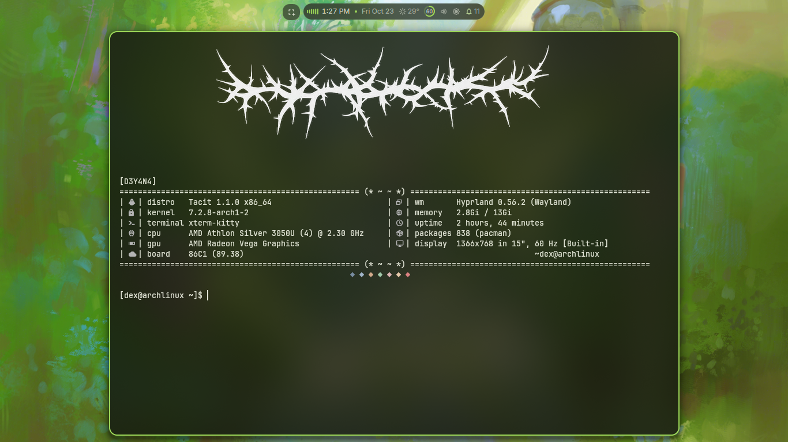

# fetch
Replaced fastfetch with a pure Bash script for full layout &amp; image control {No Fastfetch Required}
=======
# Custom System Fetch Script for Hyprland



A lightweight, self-contained **Bash system fetch script** designed for terminal customizers looking for pixel-perfect layout control, centered logo headers, and styled two-column system specifications without relying on external fetch binaries like `fastfetch` or `neofetch`.

## Features

* **No `fastfetch` required:** Built completely with native Linux utilities (`uname`, `free`, `pacman`, `uptime`, `awk`, `sed`).

* **Centered Image Header:** Displays a custom logo (`logo.png`) centered above your stats table using Kitty's native image protocol (`kitty +kitten icat`) with fallback support for `chafa`.

* **Custom Two-Column Layout:** Pre-aligned specifications box engineered specifically to prevent column collisions on various screen resolutions (tested on 1366x768).

* **Color Palette Footer:** Custom ANSI color diamonds centered beneath the system information box.

## Dependencies

Before using the script, ensure you have the following installed on your system:

* **Terminal Emulator:** [Kitty Terminal](https://sw.kovidgoyal.net/kitty/) (Recommended for full image protocol support)

* **Image Support (Optional):** `chafa` (used as a fallback renderer if required)

* **Standard Linux Core Utilities:** `bash`, `sed`, `awk`, `grep`, `tput`, `pacman` (Pre-installed on Arch Linux)

## Quick Installation & Setup

### Step 1: Clone the Repository or Download Files

Create the fastfetch configuration folder and copy the script and logo image into place:

```
mkdir -p ~/.config/fastfetch
```

Clone this repository or move the script and your `logo.png` directly:

```
# Copy fetch.sh and logo.png to ~/.config/fastfetch/
cp fetch.sh ~/.config/fastfetch/fetch.sh
cp logo.png ~/.config/fastfetch/logo.png

# Make the script executable
chmod +x ~/.config/fastfetch/fetch.sh
```

### Step 2: Test the Script

Run the script directly in your terminal to ensure image alignment and system info display correctly:

```
~/.config/fastfetch/fetch.sh
```

## Auto-Start & Shell Integration

To make `fetch.sh` run automatically every time you open a new terminal session, and to create a `fastfetch` shortcut alias, follow the instructions below for your specific shell:

### 1. Bash (`~/.bashrc`)

Open your `~/.bashrc` file in your text editor:

```
vim ~/.bashrc
```

Add the following lines at the bottom of the file:

```
# Run custom fetch on terminal startup
~/.config/fastfetch/fetch.sh

# Alias fastfetch command to run custom fetch script
alias fastfetch="~/.config/fastfetch/fetch.sh"
```

Apply the changes:

```
source ~/.bashrc
```

### 2. Zsh (`~/.zshrc`)

Open your `~/.zshrc` file in your text editor:

```
vim ~/.zshrc
```

Add the following lines at the bottom of the file:

```
# Run custom fetch on terminal startup
~/.config/fastfetch/fetch.sh

# Alias fastfetch command to run custom fetch script
alias fastfetch="~/.config/fastfetch/fetch.sh"
```

Apply the changes:

```
source ~/.zshrc
```

### 3. Fish Shell (`~/.config/fish/config.fish`)

Open your Fish shell configuration:

```
vim ~/.config/fish/config.fish
```

Add the autostart line inside your configuration file:

```
# Run custom fetch on terminal startup
if status is-interactive
    ~/.config/fastfetch/fetch.sh
end
```

To create the persistent alias in Fish:

```
alias fastfetch="~/.config/fastfetch/fetch.sh"
funcsave fastfetch
```

## File Structure

```
~/.config/fastfetch/
├── fetch.sh     # Main executable fetch script
└── logo.png     # Custom header image
```

## Customization

* **Change Logo:** Replace `~/.config/fastfetch/logo.png` with any image of your choice.

* **Adjust Image Coordinates / Grid Spacing:** Edit lines 11–15 in `fetch.sh` to modify Kitty `icat` sizing (`--place 72x12@21x0`) or cursor offset (`tput cup 13 0`).
